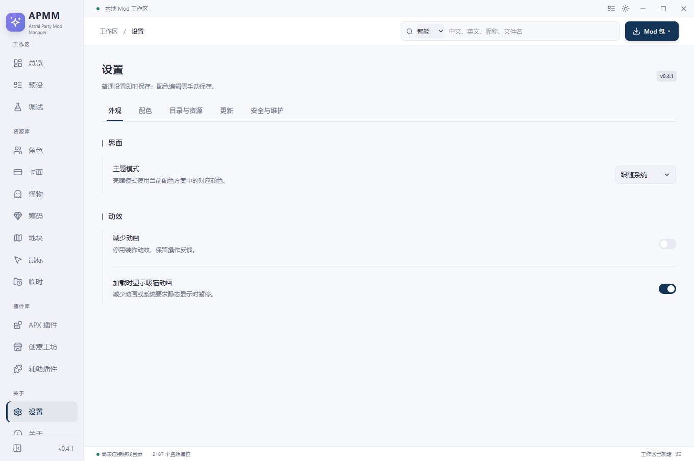
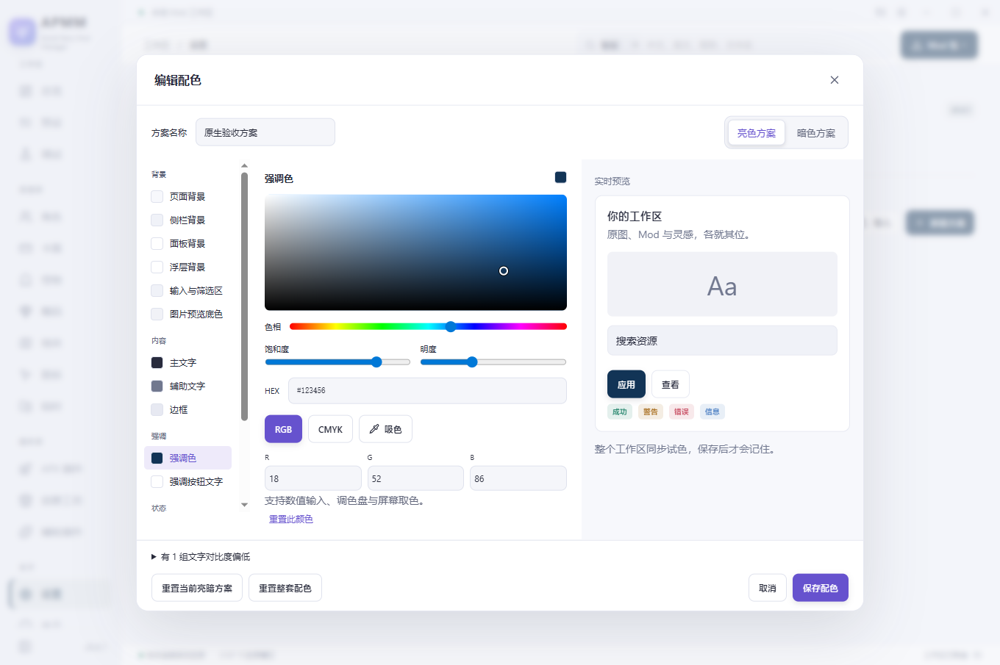

# APMM Desktop

Astral Party 图片 Mod 工作台，使用 Rust、Tauri 2、React、TypeScript、Tailwind CSS 和 Radix UI。当前版本为 0.4.10。项目采用 GPL-3.0-only，第三方归属见 [NOTICE.md](NOTICE.md)。

[便携版](https://cnb.cool/astral-weird-egg/astral-party-mod-manager-assets/-/git/raw/main/releases/0.4.10/windows-x86_64/APMM-0.4.10-windows-x86_64-portable.zip) · [安装版](https://cnb.cool/astral-weird-egg/astral-party-mod-manager-assets/-/git/raw/main/releases/0.4.10/windows-x86_64/APMM-0.4.10-windows-x86_64.msi) · [GitHub 源码](https://github.com/a190141074/APMM-next) · [CNB 源码](https://cnb.cool/astral-weird-egg/APMM-next)

## 本地启动

便携版：解压 `APMM-0.4.1-windows-x86_64-portable.zip` 到可写目录，运行 `astral-mod-manager.exe`，数据保存在程序旁的 `data`。安装版：运行 `APMM-0.4.1-windows-x86_64.msi`，程序默认安装到 Program Files/APMM，数据保存在 `%LOCALAPPDATA%/APMM`。MSI 与便携副本的数据互不接管。

旧版 0.3.36 的自动更新使用单独的 `legacy-bridge.zip`；新版按安装身份选择 MSI 或便携包。更新机制、恢复与验收边界见 [更新指南](docs/UPDATING.md)。

本地 0.3.39 测试版另提供 `compat-0.3.39.zip`，已通过真实旧程序升级验收。标准 ZIP 不能直接传给旧解包器。

第一次启动可选择旧版 `data` 目录。迁移先复制、核对摘要，再提交；不会自动向游戏重新应用 Mod。详情见 [迁移指南](docs/MIGRATION.md)。

主包不包含 Python、资产插件、游戏原图或用户 Mod。在“辅助插件”中选择“安装离线插件包”，安装独立的 `APMM-AssetTool-0.1.0-windows-x86_64.zip`。远端插件版本尚未发布，本地签名包可用于验收。

## 功能

- 图片库、搜索与分类、批量选择、Mod 对照和明确的应用按钮。
- 同编号地块和鼠标双状态的整组事务；独立文件身份与官方变体保留。
- PNG 与历史 APMMOD01/02/03 的导入、加密导出、分卷和多包队列。
- APX、工坊归属保护、预设、系统凭据默认密码。
- 统一任务中心、可校验和续传的下载、独立更新助手与启动确认。
- 横向设置分区、单行 APX 客户端标签、短淡入与方向切页、调试占位页。
- 多套命名配色，分别编辑亮暗方案；支持 HEX、RGB、CMYK、调色盘和屏幕取色，实时试色、手动保存及方案导入导出。
- 可折叠文字导航、减少动画和独立吸猫偏好。
- 可选资产插件：22 类纹理，保留原尺寸、透明度、完整名称和增量状态。

使用与兼容说明见 [更新指南](docs/UPDATING.md) 和 [迁移指南](docs/MIGRATION.md)。发行目录约定见 [发布指南](docs/RELEASING.md)。

开发准备与命令见 [CONTRIBUTING.md](CONTRIBUTING.md)，职责划分见 [架构](docs/ARCHITECTURE.md) 和 [文件清单](docs/FILE-MAP.md)。旧 APMM、NapCat 参考工程和资产工具 demo 均保留作对照。NapCat 仅提供布局与交互设计参考，新工程未复制其业务源码。

## 项目目录

- `src-ui/`：React 前端。
- `src-tauri/`：Rust 后端与 Tauri 应用。
- `config/`：共享元数据与资源清单。
- `plugins/`、`workshop-service/`：可选资产工具与本地投稿审核。
- `tools/`、`docs/`：构建工具与维护文档。

构建包和验收证据写入独立工作目录，不进入源码仓库。
